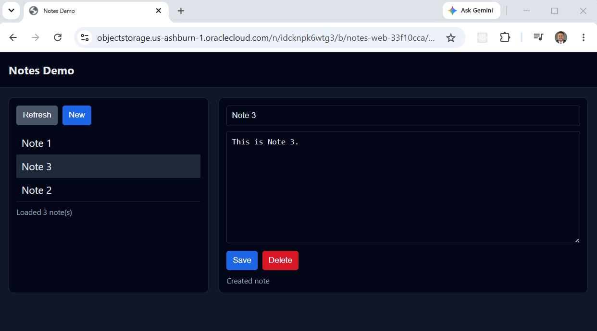
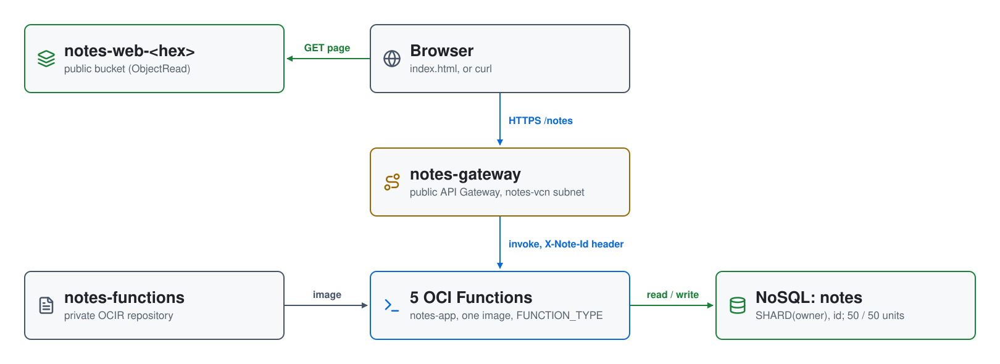

# Serverless CRUD API on OCI: API Gateway, Functions and NoSQL

A small serverless **notes** API with a browser front end. A public **OCI API
Gateway** routes five CRUD endpoints to five **OCI Functions**, all built
from one container image, which store notes in an **OCI NoSQL** table. A
single-page web app, served from a public **Object Storage** bucket, calls
the API from the browser.



| Piece | Where | Role |
|---|---|---|
| **notes-gateway** / **notes-api** | API Gateway, public | gateway in `notes-public-subnet`; deployment at `/` with five routes and CORS from any origin; the `{id}` routes pass the ID in an `X-Note-Id` header |
| **notes-app** | OCI Functions | application in the same subnet with five functions, `create-note`, `list-notes`, `get-note`, `update-note`, `delete-note`; 1 GB, 120 s timeout |
| **notes-functions** | OCIR | private repository for the image, built from `fnproject/python:3.11` and tagged with a hash of the code |
| **notes** | OCI NoSQL | table keyed on `SHARD(owner), id`; 50 read and 50 write units, 1 GB |
| **notes-vcn** | VCN `10.0.0.0/16` | one public subnet `10.0.0.0/24` with an internet gateway; the security list allows TCP 443 in |
| **notes-web-&lt;hex&gt;** | Object Storage | public-read (`ObjectRead`) bucket holding `index.html` and `favicon.ico` |
| **notes-functions-log** | Logging | function invoke logs, kept 30 days |

## Architecture

<picture>
  <source media="(prefers-color-scheme: dark)" srcset="architecture-dark.svg">
  
</picture>

Regenerate with `python3 make_diagram.py`.

- **`01-ocir/`**: the container repository.
- **`02-docker/`**: `build.sh` and the function code in `code/` (`func.py`,
  `Dockerfile`, `requirements.txt`).
- **`03-functions/`**: `network.tf`, `functions.tf`, `api.tf`, `nosql.tf`,
  `logging.tf` and `iam.tf`.
- **`04-webapp/`**: the web bucket and `index.html.tmpl`, which `apply.sh`
  fills in with the gateway URL.

## How it builds

1. **`01-ocir`** creates the `notes-functions` repository.
2. **`02-docker/build.sh`** builds the image, logs in to
   `<region>.ocir.io` (retrying for up to five minutes while a new auth token
   propagates), pushes it, and writes the image path to
   `02-docker/.build_output`.
3. **`03-functions`** deploys the network, functions, gateway, table and
   policies with that image.
4. **`04-webapp`** uploads the rendered `index.html`.

Each function's `FUNCTION_TYPE` setting tells `func.py` which operation to
run. The IAM policies, created at the tenancy root, let the Functions service
pull images and use the VCN, let API Gateway invoke functions in the
compartment, and give the dynamic group `notes-functions-dg` (all functions
in the compartment) `manage nosql-rows` and `use nosql-tables`, so the code
signs in with a resource principal and holds no keys.

## API

There's no authentication. Every note belongs to the hardcoded owner
`"global"`, the table's shard key.

| Method | Path | Function | Returns |
|---|---|---|---|
| POST | `/notes` | `create-note` | `201` `{id, title, note}`; `400` if `title` or `note` is missing |
| GET | `/notes` | `list-notes` | `{"items": [...]}` |
| GET | `/notes/{id}` | `get-note` | the note, or `404` |
| PUT | `/notes/{id}` | `update-note` | the updated note; `400` if `title` or `note` is missing, `404` if it doesn't exist |
| DELETE | `/notes/{id}` | `delete-note` | `{"message": "Note deleted"}`, or `404` |

Each note gets a UUID `id` and `created_at` / `updated_at` timestamps.

```bash
curl -s -X POST https://<gateway-host>/notes \
  -H "Content-Type: application/json" \
  -d '{"title":"Test Note 1","note":"This is test note 1"}'
```

## Prerequisites

* [An OCI Account](https://cloud.oracle.com/)
* [Install OCI CLI](https://docs.oracle.com/en-us/iaas/Content/API/SDKDocs/cliinstall.htm),
  configured with a `DEFAULT` profile in `~/.oci/config`
* [Install Terraform](https://developer.hashicorp.com/terraform/install)
* [Install Docker](https://docs.docker.com/engine/install/)
* [Install jq](https://jqlang.github.io/jq/download/) and `envsubst`

Your user needs to create policies and dynamic groups at the tenancy root.
Set `OCI_COMPARTMENT_ID` to deploy into a compartment; otherwise everything
goes into the root compartment.

## Deploy

```bash
git clone https://github.com/mamonaco1973/oci-crud-example.git
cd oci-crud-example
./apply.sh
```

`apply.sh` reads the tenancy, region and user from `~/.oci/config`. For the
OCIR login it uses the auth token cached in `~/.oci/ocir_token`, or creates
one named `notes-crud-ocir` and caches it there. After the four phases it
waits 60 seconds for the functions, then runs `validate.sh`, which creates
five notes, lists them, and fetches, updates and deletes each one:

```
NOTE: Created note 1 (id=2f2d0c5a-9f5f-4d7d-9e2c-1c8a5b8e3c21)
...
NOTE: Deleted note 2f2d0c5a-9f5f-4d7d-9e2c-1c8a5b8e3c21

=================================================================================
  Deployment validated!
=================================================================================
  API : https://<gateway-host>
  Web : https://objectstorage.<region>.oraclecloud.com/n/<namespace>/b/notes-web-<hex>/o/index.html
=================================================================================
```

## Try it

1. Open the **Web** URL and add, edit and delete notes in the page. The first
   request to each function after a while is a cold start and can take
   several seconds.
2. Or use `curl` against the **API** URL with the routes above.

## Teardown

```bash
./destroy.sh
```

`destroy.sh` destroys the phases in reverse, deletes the images before the
repository, then deletes the `notes-crud-ocir` auth token and
`~/.oci/ocir_token`.

## Notes

- **Lab only.** The API has no authentication and allows CORS from any
  origin, and the web bucket is public.
- `destroy.sh` lists images with only `--compartment-id`, so it deletes
  **every** container image in the compartment, not just `notes-functions`.
  With the default (the root compartment), that includes other projects'
  images.
- `02-docker/.build_output` is committed with an image path from a previous
  build; `build.sh` overwrites it.
